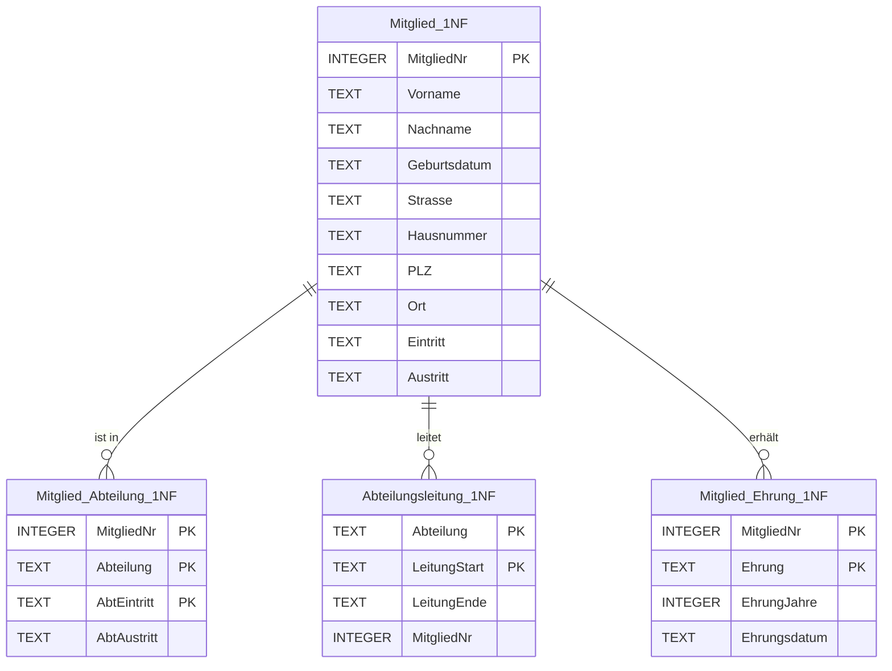
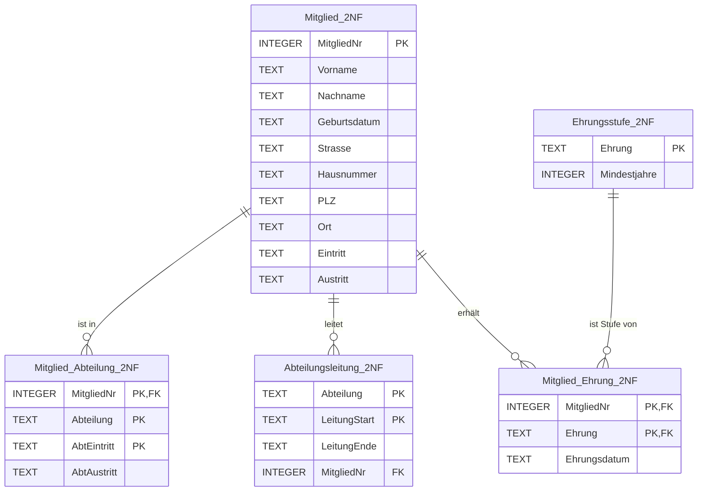
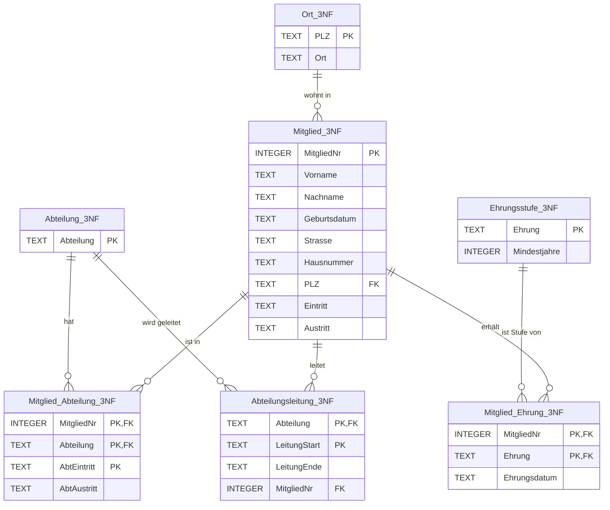

# Musterlösung

Ausführen siehe [README](../README.md). Die Skripte bauen aufeinander auf.

## Aufgabe 1: Verstöße gegen die 1NF

- **Nicht atomar:** `Name` (Vor- und Nachname), `Anschrift` (Straße, Hausnummer, PLZ, Ort)
- **Wiederholungsgruppen (Listen):**
  - Abteilungen: `Abteilungen`, `AbtEintritt`, `AbtAustritt`
  - Ehrungen: `Ehrungen`, `EhrungJahre`, `Ehrungsdatum`
  - Leitung: `LeitetAbteilung`, `LeitungStart`, `LeitungEnde`

## Aufgabe 2: 1NF – [02_to_1nf.sql](02_to_1nf.sql)

Die drei Wiederholungsgruppen sind unabhängig voneinander. Würde man sie in **einer** Tabelle
ausmultiplizieren, entstünde ein Kreuzprodukt (Antonio Banderas: 2 × 3 × 2 = 12 Zeilen).
Deshalb bekommt jede Gruppe eine eigene Tabelle.

| Tabelle | Primärschlüssel | Begründung |
|---|---|---|
| `Mitglied_1NF` | `MitgliedNr` | künstlicher Schlüssel, ändert sich nie |
| `Mitglied_Abteilung_1NF` | `MitgliedNr, Abteilung, AbtEintritt` | Wiedereintritt in eine Abteilung möglich |
| `Abteilungsleitung_1NF` | `Abteilung, LeitungStart` | pro Abteilung zu einem Zeitpunkt ein Leiter |
| `Mitglied_Ehrung_1NF` | `MitgliedNr, Ehrung` | jede Stufe pro Mitgliedschaft einmal |

## Aufgabe 3: 2NF – [03_to_2nf.sql](03_to_2nf.sql)

In `Mitglied_Ehrung_1NF` hängt `EhrungJahre` nur von `Ehrung` ab, also nur von einem Teil des
Schlüssels. Daraus wird die neue Tabelle `Ehrungsstufe_2NF`.

Die übrigen Tabellen erfüllen die 2NF bereits:
- `Mitglied_1NF` hat einen einspaltigen Schlüssel.
- In den anderen Tabellen hängen alle Attribute vom ganzen Schlüssel ab.

## Aufgabe 4 und 5: 3NF – [04_to_3nf.sql](04_to_3nf.sql)

In `Mitglied_2NF` gilt `MitgliedNr → PLZ → Ort`. Das ist eine transitive Abhängigkeit, deshalb
kommt `Ort` in eine eigene Tabelle `Ort_3NF`.

Zusätzlich gibt es die Stammtabelle `Abteilung_3NF`. Sie ist für die 3NF nicht zwingend nötig,
aber dann prüft die Datenbank Abteilungsnamen per Fremdschlüssel. Tippfehler wie „Quiddich“ statt
„Quidditch“ werden so abgewiesen.

## Zusatzaufgaben – [05_zusatz.sql](05_zusatz.sql)

- **Z1:** Die exakte Suche findet nichts, weil sich die Geburtsdaten unterscheiden (`1972-11-04` und `1972-11-07`). Erst die tolerante Suche (gleicher Name, gleiches Geburtsjahr) findet Nr. 3 und Nr. 8. Ob es wirklich dieselbe Person ist, muss ein Mensch prüfen. Die Normalisierung erkennt keine Dubletten.
- **Z2:** Das `UPDATE` ändert genau **eine Zeile**. Alle anderen Tabellen verweisen über die unveränderliche `MitgliedNr` auf das Mitglied. Wären Name oder Geburtsdatum Teil eines Schlüssels, müsste man jede Korrektur und jede Namensänderung, z.B. nach einer Heirat, in allen verweisenden Tabellen nachziehen. Vergisst man dabei eine Stelle, entsteht eine **Änderungsanomalie**. Nach der Korrektur findet auch die exakte Suche aus Z1 die Dublette.
